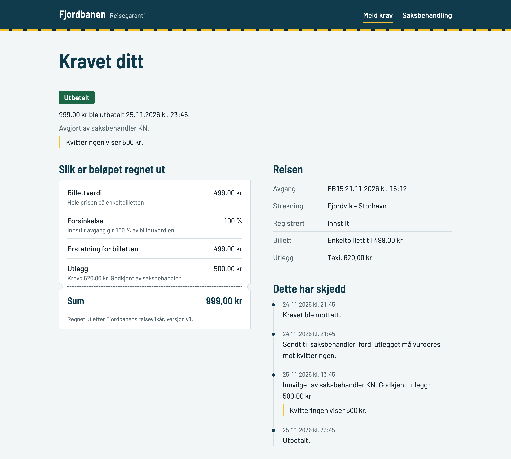

# forsinket



One claim, as the passenger sees it. The train was cancelled, so the ticket is refunded in full. The passenger also claimed 620 kr for a taxi, and an officer covered 500 kr of it. The page shows how the sum was reached, step by step, and everything that has happened to the claim.

*Forsinket* is Norwegian for *delayed*. This is a small full-stack application for compensation claims at a fictional train operator, Fjordbanen: an Elm app in the browser, and a Kotlin service written in a functional style, with PostgreSQL behind it.

This is a demo project. I have used Kotlin in production and I write TypeScript in a functional style, but I had not used Elm in a project before this one. I made it to show how I would write Elm, and how I would build the Kotlin side for a team that likes functional programming. It has not run in production.

I built it in a short time with an AI coding assistant, which is why the commits are large and close together. The choice of domain, the design decisions and the review are mine.

Fjordbanen does not exist. The rules are made up for the demo and are not any real operator's terms. All data is synthetic, and no personal data is stored: a claim has no name, e-mail or account number.

```
Elm app ──── JSON over HTTP ────► Ktor: routes, JSON, clock, ids          (the shell)
  ▲                                 │
  │                                 ├─► assess · decide · evolve          (pure functions)
  └── contract/examples ──┐         │
      tested on both sides┘         └─► PostgreSQL: an append-only event log per claim
```

## Run it

```bash
docker compose up --build
```

That is all it needs: Docker. The app is then on [http://localhost:8080](http://localhost:8080), with six demo claims in it. The interface is in Norwegian. There are three places to start:

- **[The front page](http://localhost:8080/)** says what a passenger is owed, with four worked examples.
- **[Meld krav](http://localhost:8080/krav/nytt)** is the claim form. Pick a departure and a ticket, and the calculation appears before anything is sent.
- **[Saksbehandling](http://localhost:8080/saksbehandling)** is the officers' list. Open a claim that is waiting, decide it, and record the payout.

## What it does

- **Looks up the delay.** The passenger picks the departure they travelled on. How late it was is already recorded, so nobody types in a delay.
- **Calculates, and shows its work.** 25 % of the ticket value from 30 minutes, 50 % from 60, all of it from 120 or when the train is cancelled. A period ticket counts as its price divided by its days. Every step is returned with the amount that step gave, and the app shows those steps as they are.
- **Settles what it can.** Most claims are approved or rejected the moment they are submitted. A claim with expenses that need a look at the receipt, or with a ticket compensation above 1 000 kr, waits for an officer.
- **Lets an officer decide, within the rules.** The officer sets how much of the expenses to cover, up to what the rules allow, or rejects the claim with a reason. The ticket compensation follows from the rules and is not theirs to change.
- **Keeps the record.** Every claim is stored as the list of things that happened to it. The history on the page is that list.
- **Handles two officers at once.** Whoever decides second is told the claim has changed, and nothing is overwritten.

The rules, the design decisions and the alternatives are in [RFC 0001](docs/rfc/0001-delay-compensation-claims.md).

## What to look at in the Elm code

Elm 0.19.3, a plain `Browser.application`, no framework, no ports and no flags.

- **States that cannot be wrong.** [`Claim.Status`](frontend/src/Claim.elm) is a custom type with the data of each status inside its variant. A rejected claim has no payout time, because `Rejected` has no field for one. What an officer can do is decided by pattern matching on it in [`Page.ReviewClaim`](frontend/src/Page/ReviewClaim.elm): the decision form exists for `AwaitingReview`, the payout button for `Approved`.
- **No flags in the model.** [`Remote`](frontend/src/Remote.elm) is loading, failed or loaded, never two of them. In [`Page.NewClaim`](frontend/src/Page/NewClaim.elm) the departures belong to a date and the preview belongs to the claim it was asked about, so an answer that arrives after the user has moved on is recognised and dropped.
- **A form is a parser.** [`Claim.Draft`](frontend/src/Claim/Draft.elm) holds what is typed, as text. `validate` turns it into a `NewClaim` that can be sent, or into every problem at once. [`Validation.andMap`](frontend/src/Validation.elm) collects the errors instead of stopping at the first.
- **Opaque types.** A [`Money`](frontend/src/Money.elm) is never negative and never a fraction of an øre. It parses what people type (`349`, `349,50`, `1 234,50 kr`) and formats the Norwegian way.
- **JSON decoded by hand, strictly.** Decoders fail on a variant they do not know ([`Decoding.tagged`](frontend/src/Decoding.elm)), so a status added on the server becomes a visible error, not a claim shown as something it is not.
- **Errors the user can act on.** [`Api.Error`](frontend/src/Api.elm) tells apart no connection, a timeout, a missing claim, values the service refuses, and a claim someone else changed first. The service's validation errors land on the same fields, in the same words, as the form's own.
- **No arithmetic in the browser.** The app never calculates compensation. The preview is a request to the service, so the page cannot disagree with the payout.

## What to look at in the Kotlin code

Kotlin 2.4 on JDK 25, Ktor, `arrow-core`, PostgreSQL.

- **A pure core, enforced by the build.** [`backend/domain`](backend/domain) depends on the standard library and `arrow-core` only. It has no Ktor, JDBC or serialization on its classpath, reads no clock and makes no ids.
- **Two functions.** [`decide`](backend/domain/src/main/kotlin/Decider.kt) takes a state and a command and returns the events that follow, or the reason the command is refused. `evolve` applies one event to a state. [`ClaimState`](backend/domain/src/main/kotlin/Claim.kt) is a sealed type where each state holds only the data that exists in it.
- **Rules as data.** [`assess`](backend/domain/src/main/kotlin/Assessment.kt) is a pure function from a rule set and a claim to an assessment, with every step of the calculation in the result.
- **Errors as values.** [`validateClaim`](backend/domain/src/main/kotlin/Validation.kt) returns every problem with a claim, using Arrow's `zipOrAccumulate`. An exception means a bug or corrupt data, never something a passenger or an officer did.
- **A thin shell.** [`ClaimService`](backend/app/src/main/kotlin/ClaimService.kt) does the same four things for every change: load the events, fold them to a state, call `decide`, store what it returned. The [Ktor module](backend/app/src/main/kotlin/http/Module.kt) is a function that takes its dependencies as arguments, with no annotations and no container.
- **An event log with optimistic concurrency.** [`PostgresClaimStore`](backend/app/src/main/kotlin/store/PostgresClaimStore.kt) appends events under a `(claim_id, version)` primary key, in plain SQL. Two writers on the same version collide in the database, and the loser gets a value back, not an exception.

## The contract between them

[`contract/examples`](contract/examples) has one hand-written JSON file for every request and response, including the errors. Both sides are tested against the same files:

- [`ContractTest.kt`](backend/app/src/test/kotlin/ContractTest.kt) checks that the service produces exactly these documents, and [`HttpApiTest.kt`](backend/app/src/test/kotlin/HttpApiTest.kt) checks it again over HTTP against a real database.
- [`ContractTest.elm`](frontend/tests/ContractTest.elm) checks that the decoders read them as the expected Elm values, and that the encoders write the request examples.

If one side changes a field, a test on the other side fails.

## Tests

```bash
make test     # needs JDK 25, Node 22, and Docker for the PostgreSQL the tests start
```

- **Kotlin:** unit tests for the rules, the validation and the decider. Property tests with Kotest: a longer delay never pays less, random sequences of commands only ever move a claim along the state diagram, nothing more happens to a rejected or paid claim, and no officer can make a claim pay more for expenses than the rules allow. Integration tests run the store and the whole HTTP API against PostgreSQL in Testcontainers, including a test that forces two writers to race.
- **Elm:** elm-test, with fuzz tests where a round trip must hold: an amount formatted and parsed again, a route written as an address and parsed again, and any acceptable claim typed into the form and validated. The `update` functions of the two pages with forms are tested message by message, including answers that arrive late. elm-review and elm-format run clean.
- **Together:** CI builds the Docker image, starts it with its database, and [`scripts/smoke.sh`](scripts/smoke.sh) walks two claims through it.

## Layout

```
frontend/                 the Elm app
  src/Claim.elm             a claim and its status
  src/Claim/                ticket, expenses, calculation, history, the two forms
  src/Page/                 one module per page
  src/View/                 shared views: the calculation, the history, form fields, texts
  src/Api.elm               requests, and what every kind of answer means
  src/Route.elm             the pages and their addresses
  tests/                    elm-test, including the Elm half of the contract tests
backend/
  domain/                   rules, validation, decide and evolve. No I/O
  app/                      Ktor, JSON, PostgreSQL, configuration, demo data
contract/examples/        the JSON both sides are tested against
docs/rfc/                 the design, and the alternatives
scripts/smoke.sh          two claims through the running app
```

## Development

```bash
make up          # the whole thing in Docker, on http://localhost:8080
make test        # every check CI runs, except the Docker smoke test
make dev         # the service outside Docker, with a development build of the Elm app
make contract    # copy contract/examples into the Elm test module
make smoke       # walk two claims through the running app
```

The service is configured with environment variables: `PORT`, `DATABASE_URL`, `DATABASE_USER`, `DATABASE_PASSWORD`, `WEB_ROOT`, and for an open demo `DEMO_MODE`, `DEMO_MAX_CLAIMS` and `DEMO_RESET_MINUTES`. The database password in `docker-compose.yml` is for the local setup only.

## License

MIT. See [LICENSE](LICENSE).
